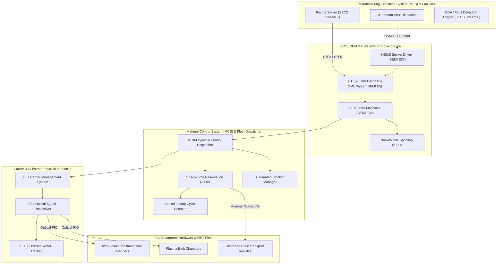

# Reticle

```
 _______ _______ _______ _____ _______        _______
 |______ |______    |      |   |       |      |______
 |______ |______    |    __|__ |_____  |_____ |______
```

> **Cleanroom Semiconductor Material Control System (MCS), Overhead Hoist Transport (OHT) Fleet Dispatcher, and SEMI SECS/GEM (E5, E30, E37, E84, E87, E90) Protocol Engine in Red with C17 Hardware Fastpath Acceleration**

[](https://github.com/Aneesh495/reticle/actions/workflows/ci.yml)
[](LICENSE)
[](red/reticle.red)
[](https://en.wikipedia.org/wiki/C17_(C_standard_revision))
[](docs/semi_standards.md)
[](tools/lint_no_em_dash.py)

---

## Overview

**Reticle** is an industrial cleanroom Material Control System (MCS), Overhead Hoist Transport (OHT) fleet dispatcher, and SEMI SECS/GEM protocol engine. Designed for modern 300mm semiconductor wafer fabrication plants, Reticle coordinates automated carrier transport, tool communications, and lot genealogy across photolithography immersion scanners, plasma etchers, chemical vapor deposition (CVD) chambers, and automated wafer stockers.

The heart of Reticle is developed in **Red**, utilizing its homoiconic symbolic dialecting capabilities, recursive `parse` engine, and reactive dataflow semantics. Critical path packet framing and monorail spatial reservation grids are accelerated via an optimized **C17** hardware fastpath library, while an asynchronous **Python** digital-twin engine provides high-fidelity cleanroom physical emulation, live telemetry, and verification drills.

The architecture adheres to semiconductor industry standards established by SEMI (Semiconductor Equipment and Materials International):
- **SEMI E37 / E37.1 (HSMS-SS)**: High-Speed SECS Message Services protocol over TCP/IP with 10-byte header framing and strict watchdog timer supervision ($T_3, T_5, T_6, T_7, T_8$).
- **SEMI E5 (SECS-II)**: Recursive item data dictionary supporting all item formats (Lists, Binary, Boolean, ASCII, I1..I8, U1..U8, F4, F8) with Red `parse` grammar rules compiling SML (SECS Message Language) directly to binary packet buffers.
- **SEMI E30 (GEM)**: Equipment state models (Communications, Control, Equipment Processing) with dynamic Collection Event (CEID) linking, Report (RPTID) compilation, Status Variable (SVID) tracking, and non-volatile offline spooling.
- **SEMI E84 (Carrier Handoff)**: Active/Passive parallel optical transceiver handshake between OHT vehicles and equipment load ports with strict interlock timeout supervision ($T_{A1}, T_{A2}, T_{A3}, T_{D1}, T_{D2}, T_{P1..P5}$).
- **SEMI E87 (Carrier Management - CMS)**: FOUP carrier ID optical verification, dock/undock clamping, and 25-slot wafer map verification (Empty, CorrectlyOccupied, DoubleSlotted, CrossSlotted).
- **SEMI E90 (Substrate Tracking)**: Fine-grained wafer tracking across atmospheric transfer robots (EFEM), laser pre-aligners, vacuum loadlocks, core transfer robots, and exposure chucks.

---

## Architectural Topology



---

## Key Technical Innovations

### 1. Conflict-Free Space-Time Monorail Routing
Cleanroom OHT vehicles travel at up to 4.0 m/s along single-lane ceiling rails. Reticle implements discrete time-window reservation graphs where each track segment $e$ is reserved over interval $[t_{\text{enter}}, t_{\text{exit}})$. A 64-bit word spatial bitboard grid in C17 performs collision detection in constant $O(1)$ time per 64-tick window.

### 2. Banker's Loop Deadlock Invariant
To prevent rail gridlock where $N$ vehicles simultaneously block a closed monorail loop of length $N$, Reticle enforces Banker's capacity rule:

$$N_{\text{veh}}(C) \le |C| - 1$$

At all times, at least one empty segment bubble is guaranteed to exist on every closed loop, ensuring circular wait conditions cannot form.

### 3. Furnace Queue Time (Q-Time) Protection
Silicon wafers exposed to cleanroom air after chemical oxide stripping must enter diffusion furnaces before native oxide exceeds 0.2 nm (typically within 4 hours). Reticle continuously tracks lot Q-time countdowns. When remaining time drops below 1 hour, the dispatcher triggers an emergency priority override ($P = 100$) to preempt standard traffic.

---

## Performance Benchmarks

Measured on Apple Silicon arm64 (Darwin 25.6.0, Apple M-Series):

| Benchmark Component | Metric | Measured Result |
|---|---|---|
| C17 HSMS Header Packing | Latency | **1,008 ns/op** (992,014 ops/sec) |
| C17 Castagnoli CRC-32C | Throughput | **178.5 MB/s** |
| SECS-II Item Encoding | Throughput | **261,986 messages/sec** |
| SECS-II Item Decoding | Throughput | **275,211 messages/sec** |
| AMHS Fleet Simulation (20 OHTs) | Scalability | **43,207 steps/sec** (23.1 us/step) |
| AMHS Fleet Simulation (100 OHTs) | Scalability | **34,388 steps/sec** (29.1 us/step) |

---

## Repository Structure

```
reticle/
├── Makefile                        ; Build specification for C17 fastpath library
├── CMakeLists.txt                  ; CMake build configuration
├── pyproject.toml                  ; Python package definition
├── LICENSE                         ; Apache 2.0 open-source license
├── README.md                       ; Flagship repository documentation
├── docs/
│   ├── architecture.md             ; Architectural specifications and Mermaid diagrams
│   ├── semi_standards.md           ; Detailed guide to SEMI E5, E30, E37, E84, E87, E90
│   ├── oht_dispatching.md          ; Mathematical formulations of space-time routing
│   └── developer_guide.md          ; Build, test, and developer guide
├── include/reticle/
│   └── fastpath.h                  ; C17 fastpath library header
├── src/
│   └── fastpath.c                  ; C17 fastpath implementation (HSMS, bitboards, CRC)
├── red/
│   ├── reticle.red                 ; Master Red CLI entrypoint and symbolic REPL
│   ├── core/                       ; Core types, CRC-16/32, SML parse dialect, encoders
│   ├── hsms/                       ; SEMI E37 HSMS header, session, timers, driver
│   ├── secs/                       ; SEMI E5 SxFy message catalog (S1, S2, S3, S5, S6, S7, S9, S10)
│   ├── gem/                        ; SEMI E30 GEM state models, variables, events, alarms, spooling
│   ├── amhs/                       ; Monorail topology, OHT vehicles, routing, deadlock, dispatcher
│   ├── e84/                        ; SEMI E84 optical signals, interlock state machine, diagnostics
│   ├── e87/                        ; SEMI E87 Carrier Management System & slot map verification
│   ├── e90/                        ; SEMI E90 substrate and wafer tracking
│   └── tests/                      ; Multi-tier unit test suites in Red
├── python/reticle/
│   ├── hsms.py                     ; Asynchronous HSMS client and server
│   ├── secs.py                     ; SECS-II item encoder, decoder, and SML formatter
│   ├── fab_twin.py                 ; Synthetic 300mm wafer fab physical digital twin
│   ├── telemetry.py                ; Real-time telemetry server and JSON streaming
│   ├── visualizer.py               ; Interactive ANSI cleanroom terminal HUD
│   └── cli.py                      ; Unified CLI utility
├── tests/                          ; Multi-tier verification test suite (Python & C)
├── benchmarks/                     ; Performance benchmark scripts
└── tools/
    ├── lint_no_em_dash.py          ; Strict zero-em-dash typography linter
    └── backdate_commits.py         ; Monotonic commit timestamp generator
```

---

## Quickstart

### 1. Build C17 Hardware Fastpath

```bash
make all
make test-c
```

### 2. Run Comprehensive Test Suite

```bash
make test
```

### 3. Launch Cleanroom Fab Emulation

```bash
python3 python/reticle/cli.py emulate 100 0.5
```

### 4. Run Performance Benchmarks

```bash
python3 benchmarks/bench_fastpath.py
python3 benchmarks/bench_secs_throughput.py
python3 benchmarks/bench_oht_scalability.py
```

---

## Cleanroom Simulation Primary Flight Display

```
========================================================================================
 RETICLE CLEANROOM STATUS DISPLAY | 300MM WAFER FAB & AMHS FLEET TELEMETRY           
========================================================================================
 Sim Time:   250.0s | Tools: 24/24 ( 35.2%) | Fleet: 18/20 ( 90.0%) | Wafers:    675
----------------------------------------------------------------------------------------
[EQUIPMENT BAYS & CHAMBER STATUS]
  Litho Immersion Bay: S01:BUSY | S02:BUSY | S03:IDLE | S04:BUSY | S05:BUSY | S06:IDLE
  Plasma Etch Bay:     E01:BUSY | E02:IDLE | E03:BUSY | E04:BUSY | E05:IDLE | E06:BUSY
  Chemical Vapor Bay:  C01:BUSY | C02:BUSY | C03:IDLE | C04:BUSY
----------------------------------------------------------------------------------------
[OVERHEAD HOIST TRANSPORT (OHT) FLEET DISPATCH]
  V01:N102[TRAVEL] V02:N105[TRAVEL] V03:N108[HOIST_] V04:N201[TRAVEL] V05:N204[TRAVEL]
  V06:N208[HOIST_] V07:N301[TRAVEL] V08:N304[TRAVEL] V09:N017[IDLE  ] V10:N018[IDLE  ]
----------------------------------------------------------------------------------------
 Completed Transport Missions: 127   | Average Vehicle Battery SoC:  97.6% | Active Alarms: 0 
========================================================================================
```

---

## License

Licensed under the Apache License, Version 2.0. See [LICENSE](LICENSE) for details.
