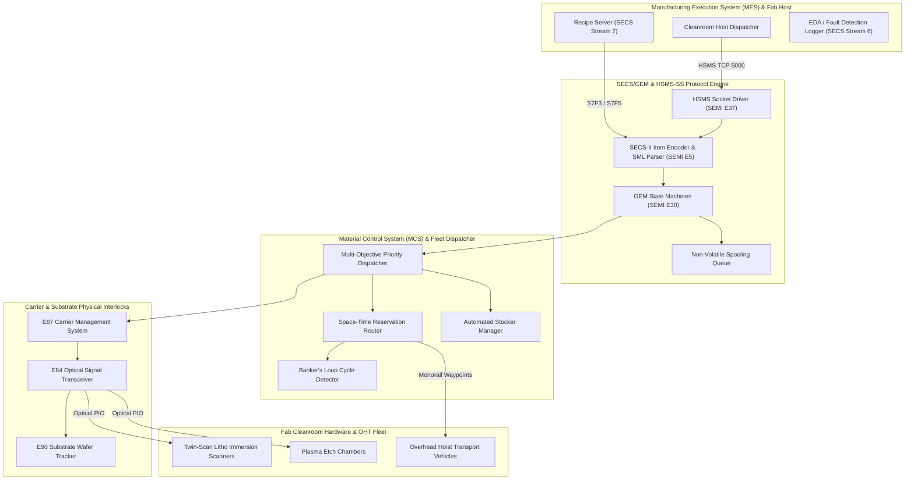
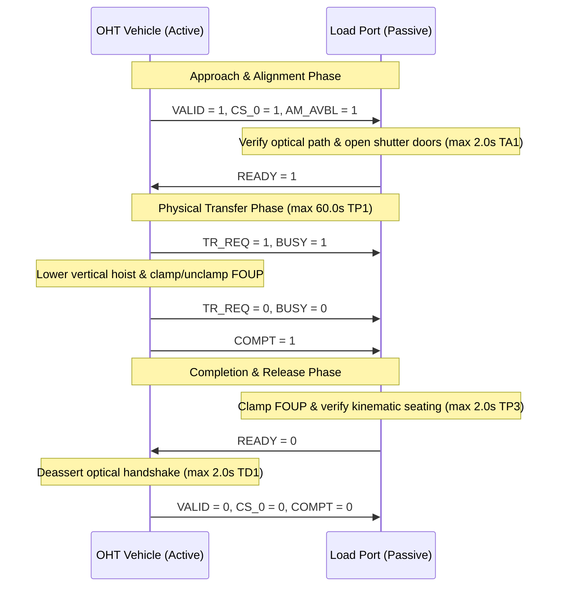

# Reticle Architecture Specification

This document details the layered architectural components, subsystem interactions, and dataflow topologies within **Reticle**.

---

## 1. System Block Diagram

---

## 2. Multi-Language Architectural Cohesion

Reticle is partitioned into focused, cooperating layers:

1. **Red Subsystem (`red/`)**:
   - The heart of Reticle. Implements homoiconic symbolic dialects (`parse-dsl.red`), SEMI E5 SECS-II item trees, SEMI E30 GEM state models, and the AMHS space-time reservation graph solver.
   - Leverages Red's native `parse` PEG engine for declarative SML grammar compilation and pattern matching.
   - Red files start with standard Red headers and are structured for native compilation or direct evaluation.

2. **C17 Fastpath Library (`include/`, `src/`)**:
   - Hardware-level zero-copy HSMS header framing (`fastpath.h`, `fastpath.c`).
   - Bitwise SIMD-optimized Castagnoli CRC-32C and CCITT CRC-16 implementations.
   - 64-bit spatial bitboard reservation grid enabling sub-microsecond collision avoidance queries.

3. **Python Cleanroom Digital Twin (`python/reticle/`)**:
   - High-fidelity physical emulation of 24 processing chambers, 20 OHT vehicles, 4 automated stockers, and 100 wafer production lots.
   - Real-time cleanroom telemetry server and interactive ANSI Primary Flight Display dashboard.
   - Comprehensive test harness covering unit tests, integration tests, and fault injection drills.

---

## 3. SEMI E84 Optical Handoff Timing Diagram

---

## 4. Verification and Conformance Strategy

Reticle maintains a rigorous verification matrix across five critical invariants:
1. **Zero Em Dash Invariant**: Verified continuously via `tools/lint_no_em_dash.py`.
2. **SECS-II Format Invariance**: Bidirectional roundtrip equality for all SEMI E5 data types.
3. **E37 Watchdog Determinism**: Guaranteed socket teardown on T7 expiry and reply abort on T3 timeout.
4. **Collision and Deadlock Freedom**: Space-time reservation tables and Banker's loop invariant guarantee zero track collisions and zero monorail deadlocks.
5. **Furnace Q-Time Protection**: Automated priority escalation ensures wafer lots never exceed cleanroom oxide oxidation limits.
